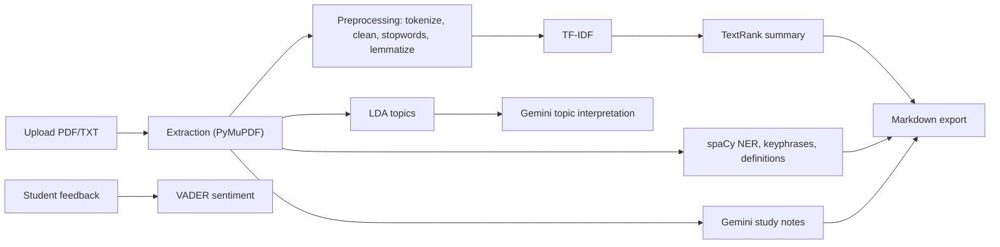

# Educational Content Summarization System

NLP mini-project (Course 2311217L – NLP Lab) that turns educational documents (PDF/TXT) into structured study material through a transparent, stage-by-stage NLP pipeline, with Google Gemini for generative study notes.

- **Live app:** _add your Streamlit Cloud URL here_
- **Tech:** Python 3.12 · Streamlit · PyMuPDF · NLTK · spaCy · scikit-learn · networkx · Google Gemini (`google-genai`)

---

## 1. Problem Statement

Students and educators deal with long educational documents. Manually summarizing them, extracting key concepts and definitions, and preparing revision notes takes a lot of time. Pure LLM tools produce answers without showing how they were obtained. This project builds an NLP pipeline where **classical NLP algorithms do the analysis and show every intermediate result**, and Generative AI is added on top for structured study notes.

## 2. Objectives

1. Extract text from PDF and TXT documents.
2. Preprocess text: sentence/word tokenization, cleaning, stopword removal, lemmatization.
3. Vectorize text with TF-IDF.
4. Generate an extractive summary with TextRank and display its similarity matrix and PageRank scores.
5. Extract named entities, keyphrases and definitions.
6. Discover topics with LDA and interpret them with a cloud LLM.
7. Analyze student feedback sentiment with VADER.
8. Generate short/detailed summaries, bullet notes, definitions and exam revision notes with Google Gemini using engineered prompts.

## 3. Course Outcome Mapping

| CO | Requirement | Where it is implemented |
|---|---|---|
| CO1 (7) | Text extraction, preprocessing, cleaning, vectorization | Stages 1–7 (`src/extraction`, `src/preprocessing`) |
| CO2 (8) | Sentiment analysis & information extraction | VADER feedback section (`src/sentiment`), Stage 9 NER/keyphrases/definitions (`src/information_extraction`) |
| CO3 (7) | Topic modelling with cloud-based AI services | Stage 10 LDA (`src/topic_modeling`) + Gemini cloud topic interpretation |
| CO4 (8) | Generative AI / LLM, prompt engineering, integration | Stage 11 Gemini summaries (`src/summarization/llm_*`, `prompts.py`) |

## 4. Methodology – The 11-Stage Pipeline

| # | Stage | Algorithm / Library | What is displayed |
|---|---|---|---|
| 1 | Text Extraction | PyMuPDF, TXT decoding | filename, pages, characters, words, warnings, text |
| 2 | Sentence Tokenization | NLTK Punkt | numbered sentence list |
| 3 | Word Tokenization | NLTK `word_tokenize` | token count and tokens |
| 4 | Text Cleaning | Unicode NFC, regex normalization | original vs cleaned text |
| 5 | Stopword Removal | NLTK stopwords (negations kept) | removed stopwords, remaining tokens |
| 6 | Lemmatization | WordNet lemmatizer (POS-aware) | Original → Lemma table |
| 7 | TF-IDF Vectorization | scikit-learn `TfidfVectorizer` | vocabulary, matrix shape, top terms, matrix |
| 8 | TextRank Summarization | TF-IDF + cosine similarity + PageRank (networkx) | similarity matrix, graph, scores, ranked & selected sentences, compression ratio |
| 9 | Information Extraction | spaCy `en_core_web_sm` NER, noun chunks, regex definition patterns | entities with labels & char offsets, keyphrases, definitions |
| 10 | LDA Topic Modelling | scikit-learn `CountVectorizer` + `LatentDirichletAllocation`; optional Gemini interpretation | chunks, BoW matrix, topic keywords/weights, document-topic distribution |
| 11 | Gemini Summarization | Google Gemini via `google-genai`, 5 versioned prompts, chunking, retries | short/detailed summary, bullet notes, definitions, revision notes |
| – | Student Feedback Sentiment | NLTK VADER | pos/neg/neu/compound scores, label, batch distribution |

Every stage has its own **▶ Run** button (missing prerequisites run automatically) and live progress feedback; **Run Complete Pipeline** runs all stages in order.

### Prompt Engineering
`src/summarization/prompts.py` holds versioned templates (short, detailed, bullets, definitions, revision, topic interpretation). Each prompt restricts the model to the supplied text, asks it to keep terminology, forbids invented definitions, requires it to say when information is missing, and enforces a fixed Markdown output structure. Long documents are split into sentence-aligned chunks and the partial summaries are merged.

## 5. System Architecture



```text
educational_content_summarization/
├── app.py                     # Streamlit UI (calls src/ modules only)
├── requirements.txt
├── pyproject.toml
├── .env.example               # template; real .env is git-ignored
├── DEPLOYMENT.md
├── src/
│   ├── extraction/            # PDF + TXT extraction
│   ├── preprocessing/         # cleaning, tokenization, lemmatization, TF-IDF
│   ├── summarization/         # TextRank, Gemini client, prompts
│   ├── information_extraction/# NER, keyphrases, definitions
│   ├── topic_modeling/        # LDA
│   ├── sentiment/             # VADER
│   ├── evaluation/            # ROUGE, classification metrics, concept F1
│   ├── ui/                    # export helpers
│   └── utils/                 # configuration, logging
├── tests/                     # pytest suite
├── data/
│   ├── raw/                   # sample educational PDF
│   └── evaluation/            # demo datasets, templates, report
├── docs/                      # architecture, algorithms, dataset, demo script, poster content
├── scripts/                   # optional Gemini connection check
├── screenshots/               # application output screenshots
└── .github/workflows/ci.yml   # automated tests on every push
```

More detail: [docs/ARCHITECTURE.md](docs/ARCHITECTURE.md), [docs/ALGORITHMS.md](docs/ALGORITHMS.md).

## 6. Dataset

A sample author-created 7-page educational PDF is included at `data/raw/educational_content_nlp_test_document.pdf`, plus small demo evaluation sets in `data/evaluation/`. Any PDF/TXT can be uploaded at runtime. See [docs/DATASET.md](docs/DATASET.md) for source, description and preprocessing details.

## 7. Installation

```powershell
git clone https://github.com/SwapnilAkhade824/educational-content-summarization.git
cd educational-content-summarization
python -m venv .venv
.\.venv\Scripts\Activate.ps1          # Linux/macOS: source .venv/bin/activate
pip install -r requirements.txt       # includes the spaCy en_core_web_sm model
Copy-Item .env.example .env           # Linux/macOS: cp .env.example .env
```

Edit `.env` and set `GEMINI_API_KEY` (from Google AI Studio). Without a key, Stages 1–10 and sentiment analysis still work; only Gemini features are disabled. NLTK resources are downloaded automatically on first run.

## 8. Running the Application

```powershell
streamlit run app.py
```

1. Upload a PDF/TXT in the sidebar (or use the sample PDF in `data/raw/`).
2. Click **▶ Run Complete Pipeline**, or **▶ Run** on any individual stage.
3. Expand each stage to inspect intermediate results.
4. Use the sentiment section for student feedback, and download study notes at the bottom.

## 9. Testing

```powershell
python -m pytest -q
```

202 tests cover extraction, preprocessing, TF-IDF, TextRank, information extraction, LDA, VADER, Gemini integration (mocked), prompts, configuration and the app pipeline. GitHub Actions runs them on every push.

## 10. Deployment

Deployed on Streamlit Community Cloud with the Gemini key stored in app secrets. Steps: [DEPLOYMENT.md](DEPLOYMENT.md).

## 11. Output Screenshots

Screenshots of the interface and sample outputs are in [`screenshots/`](screenshots/).

## 12. Limitations

- TextRank is extractive; quality depends on sentence similarity.
- Definition extraction is pattern-based.
- VADER may misread sarcastic or domain-specific feedback.
- LDA needs enough text to form distinct topics; perplexity is not coherence.
- No OCR for scanned PDFs.
- Gemini features need an API key and network access.

## 13. Security

API keys are read only from environment variables / Streamlit secrets. `.env` is git-ignored and never committed.
